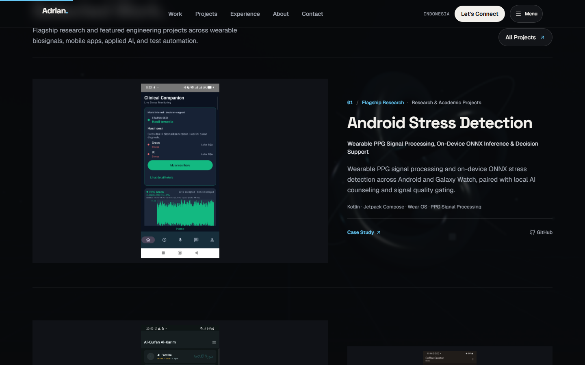
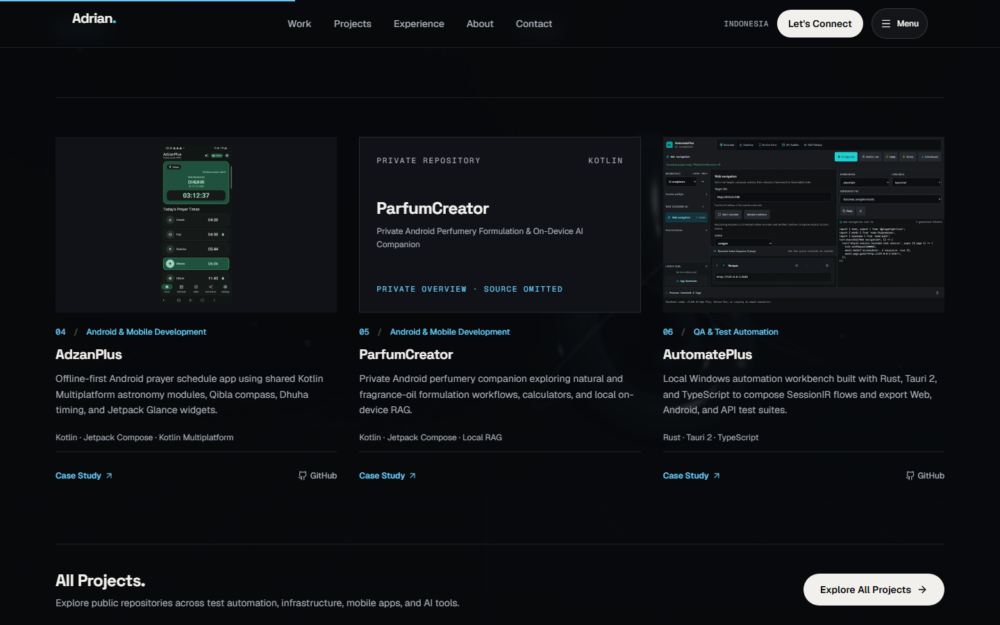

# Adrian Syah Abidin — Engineering Portfolio

Build-ready hybrid Next.js 16 engineering portfolio showcasing software work across **QA Automation / SDET**, **DevOps & DevSecOps**, **Backend & Financial Systems**, **Android & Wear OS Research**, and **On-Device Applied AI** — enhanced with **Ask Adrian**, a privacy-guarded bilingual AI assistant. Built with Next.js 16 (statically prerendered pages + Node.js `/api/chat/` route), strict TypeScript, Tailwind CSS v4 (`Obsidian & Arctic`), Three.js / React Three Fiber with custom GLSL shaders, GSAP, and Lenis.

**Production Site:** [adriansyahabidin.vercel.app](https://adriansyahabidin.vercel.app)

---

## Preview

| Flagship Research (`01 / Android Stress Detection`) | Curated Featured Grid & Private Summary (`04–06`) |
| --- | --- |
|  |  |

---

## Featured & Flagship Work (`Selected Work`)

Editorial ordering on `/` and `/projects/` is pinned via `FEATURED_PROJECT_ORDER` in `src/lib/projects.ts` so `npm run sync:github` refreshes never displace flagship or curated work:

| Slot | Project | Focus & Public Boundary |
| --- | --- | --- |
| `01` | **Android Stress Detection** *(Flagship Research)* | Wearable PPG signal processing & channel-independent on-device ONNX inference (`App` + `Wear OS`). Experimental decision-support prototype — not a medical diagnostic tool. |
| `02` | **QuranPlus** | Offline-first Android 30 Juz Quran, 9-kitab Hadith search, Tahsin drills, and `sqlite-vec` / LiteRT-LM on-device RAG. |
| `03` | **Coffee Creator** | Offline-first Kotlin & Jetpack Compose brewing lab with extraction calculators, haptic pour-over timer, and CVA cupping forms. |
| `04` | **AdzanPlus** | Shared Kotlin Multiplatform (`core-astronomy`, `core-prayer`) offline prayer times, Qibla compass, and Jetpack Glance widgets. |
| `05` | **ParfumCreator** | Local-first Android perfumery studio with 232 study templates, 2,046+ ingredients, C++17 NDK math, and on-device MiniLM RAG + LiteRT-LM (`v1.3.1`). |
| `06` | **AutomatePlus** *(+ additional featured projects)* | Rust, Tauri 2 & TypeScript multi-platform SDET workbench compiling `SessionIR` flows into Playwright, Selenium, Appium, and k6 suites. |

Enterprise engineering engagements at **Berijalan Techno Center — ACC Group** (*Archer Upgrade*, *STNK Alignment*, *Advanced Joint Finance Parameter*) are presented strictly as non-interactive experience records under `#experience` without exposing internal URLs, schemas, or proprietary artifacts.

---

## Architecture & Stack

- **Framework:** Next.js 16 (App Router, statically prerendered `/`, `/projects/`, `/projects/[slug]/`, `/resources/`, `/resources/[slug]/` routes + Node.js serverless `POST /api/chat/`)
- **AI Portfolio Assistant (`Ask Adrian`):** Canonical knowledge base `knowledge/adrian-knowledge.json`, deterministic bilingual FAQ-first routing, PII/secret guardrails, visitor rate limits + daily budget caps, and ordered provider fallback (`Groq -> Gemini -> OpenRouter Free -> Local Fallback`; see [docs/deployment/VERCEL_ASK_ADRIAN_SETUP.md](docs/deployment/VERCEL_ASK_ADRIAN_SETUP.md))
- **Quick Profile Share & Static QR:** Double-click (desktop), Pointer Events double-tap (touchscreens), or click the Hero `QrCode` action to open `ProfileShareDialog` featuring static high-contrast SVG QR ([public/images/profile/portfolio-qr.svg](public/images/profile/portfolio-qr.svg)), Clipboard copy + fallback, and Web Share API support.
- **Language:** TypeScript (`strict: true`)
- **Design Tokens & Typography:** Tailwind CSS v4 (`Obsidian & Arctic`: `#08090C`, `#15171C`, `#1C1F26`, `#F2F0EC`, `#A7ADB7`, `#65C8F5`; `Space Grotesk`, `Geist`, `Geist Mono`)
- **3D & Shaders:** Three.js + React Three Fiber (`SpatialScene`, custom GLSL `atmosphereShader.ts` and `horizonGridShader.ts`, runtime `High` / `Balanced` / `Reduced` quality modes, WebGL & `prefers-reduced-motion` static geometry fallback)
- **Motion & Microinteractions:** GSAP (`@gsap/react`) + Lenis smooth scroll (`portfolio:scroll-top` coordination) + native-scale desktop `VIEW` cursor
- **Icons:** Lucide React
- **Verification & QA:** Vitest (unit & ordering invariants), Playwright + `axe-core` (E2E, `320px`–`1920px` responsive overflow checks, WCAG 2.2 AA), and `scripts/validate-assets.mjs` (case-sensitive asset & binary header verification across `public/` and `out/`)

---

## Repository Structure

```text
adrian-portfolio/
├── design/                        # Design tokens and FigCraft source + exports
├── docs/                          # Audits (V3–V6), Design System, Architecture & Visual Evidence
├── public/
│   ├── images/avatar/             # WebP workstation illustrations
│   ├── projects/                  # Verified local WebP project screenshots
│   └── og-image.png               # Static 1200×630 Open Graph preview image
├── scripts/
│   ├── sync-github.mjs            # Paginated offline GitHub snapshot generator
│   └── validate-assets.mjs        # Case-sensitive static asset & binary header validator
├── specs/                         # GitHub Spec Kit specs (001 through 006)
├── src/
│   ├── app/                       # App Router pages (/, /projects, /projects/[slug], sitemap, robots)
│   ├── components/
│   │   ├── avatar/                # ChibiShowcase
│   │   ├── layout/                # Navbar, Footer
│   │   ├── motion/                # DesktopCursor, MagneticSurface, RollText, ScrollParallax, Lenis
│   │   ├── projects/              # ProjectCard, ProjectExplorer, ProjectHoverPreview, CaseStudyDetail
│   │   ├── sections/              # Homepage sections (Hero, SelectedWork, Experience, Competencies, etc.)
│   │   ├── three/                 # SpatialWidget, SpatialBackground, SpatialScene, SpatialFallback
│   │   └── ui/                    # Badge, ResilientImage, SectionHeader, TiltSurface, TimelineItem
│   ├── context/                   # MotionContext (quality tiers & reduced-motion state)
│   ├── data/                      # github-repositories.json, curated-projects.ts, project-overrides.ts, experience.ts
│   ├── hooks/                     # Motion capability detection
│   ├── lib/                       # Editorial ranking, filtering, URL safety, and catalog validation
│   ├── shaders/                   # atmosphereShader.ts, horizonGridShader.ts
│   └── types/                     # Domain TypeScript definitions
└── tests/
    ├── unit/                      # Vitest suites
    └── e2e/                       # Playwright + axe-core E2E & accessibility suite
```

---

## Updating Projects & Verifying Locally

Project metadata is synchronized offline so the exported static site never calls GitHub APIs at runtime:

1. Sync public repositories from `@Adrian463588` (optionally set `GITHUB_TOKEN` locally; never commit tokens or use `NEXT_PUBLIC_*`):
   ```bash
   npm run sync:github
   ```
2. Curate flagship rankings, case study narratives, and screenshots in `src/data/project-overrides.ts`, `src/data/curated-projects.ts`, and `src/lib/projects.ts` (`FEATURED_PROJECT_ORDER`).
3. Run the full verification pipeline:
   ```bash
   npm run validate:assets
   npm run lint
   npm run typecheck
   npm run test
   npm run build
   npm run validate:assets
   npm run test:e2e
   ```

## Local Development

```bash
npm ci
npm run dev
```

Open [http://localhost:3000](http://localhost:3000).
